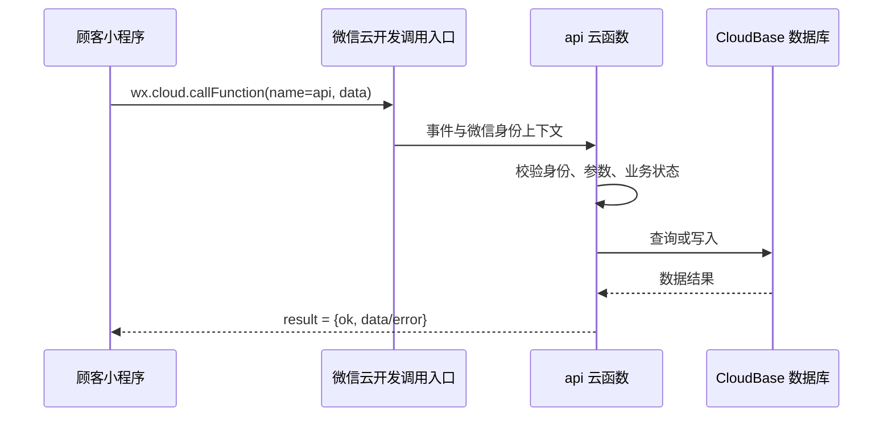
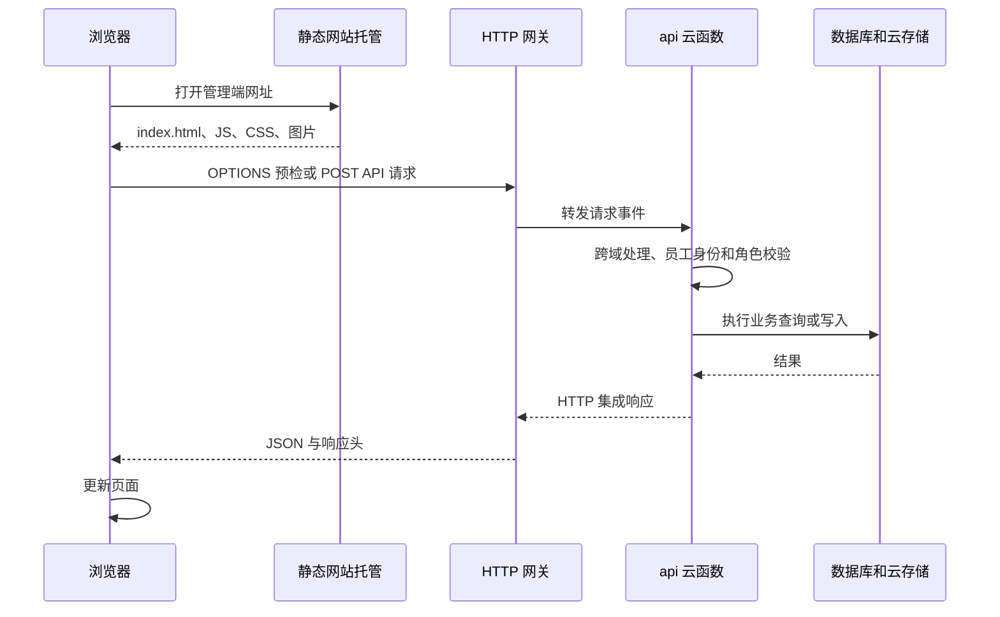

# 餐厅点餐项目：目录与云端连接详细说明

更新时间：2026-11-13。

本文根据当前项目文件编写，说明目录职责、页面流程、数据存放位置，以及小程序、Web 管理端、CloudBase 云函数、HTTP 网关和静态网站之间的关系。

> 阅读约定：文中的目录相对于项目根目录 `D:\新建文件夹`。代码已经实现或本地构建成功，不等于对应版本已部署到云端。文末单独说明当前验证情况。

## 1. 先理解项目由哪几部分组成

项目由三个主要程序组成：

| 程序 | 谁使用 | 在哪里运行 | 负责什么 |
| --- | --- | --- | --- |
| 微信小程序 | 顾客 | 微信或微信开发者工具 | 选桌、点菜、共享购物车、模拟支付、查看本桌订单 |
| Web 管理端 | 管理员、前台、后厨 | 浏览器 | 菜单管理、桌台管理、订单确认、制作、上桌和营业概览 |
| `api` 云函数 | 两个客户端共同调用 | CloudBase 云环境 | 校验身份与权限、处理业务、访问数据库和云存储 |

另外还有三类云端资源：

- **数据库**：保存菜单、桌台、员工账号、桌次、共享购物车和订单。
- **云存储**：保存上传后的菜品图片文件。
- **静态网站托管**：保存 Web 管理端构建后的 HTML、JavaScript、CSS 和静态图片。

平时说的“后台”容易混淆：浏览器里的操作界面是 **Web 管理端**；真正处理数据和权限的是 **`api` 云函数**。静态网站托管负责把页面文件交给浏览器，数据库操作由云函数完成。

## 2. 项目目录总览

```text
D:\新建文件夹\
├─ apps/
│  └─ admin/                     Web 管理端项目
│     ├─ src/                    React 页面、请求封装和样式源码
│     ├─ public/
│     │  └─ dish-images/          Web 本地菜品图片备用资源
│     ├─ dist/                   构建后的静态网站上传文件
│     ├─ .env.example            配置模板
│     ├─ .env.local              本地开发配置
│     ├─ .env.production.local   当前生产构建配置
│     ├─ vite.config.ts          Vite 构建及本地代理配置
│     ├─ package.json            管理端依赖与运行命令
│     └─ 其他 TypeScript、HTML 等工程配置
├─ cloudfunctions/
│  └─ api/                      名称为 api 的云函数项目
│     ├─ index.ts                云函数业务源码
│     ├─ index.js                加载编译产物的入口
│     ├─ dist/
│     │  └─ index.js             TypeScript 编译后的云函数实现
│     ├─ config.json             云函数 OpenAPI 权限声明
│     ├─ package.json            云函数依赖与构建命令
│     ├─ tsconfig.json           云函数 TypeScript 编译配置
│     └─ wx-server-sdk.d.ts      SDK 类型声明补充
├─ miniprogram/
│  ├─ pages/
│  │  ├─ tables/                 选桌页
│  │  ├─ menu/                   菜单、规格和共享购物车页
│  │  ├─ payment/                模拟支付页
│  │  └─ orders/                 本桌订单页
│  ├─ utils/
│  │  ├─ api.js                  小程序云函数调用及模拟数据封装
│  │  └─ dish-images.js          菜名到本地图片的映射
│  ├─ assets/
│  │  └─ dishes/                 小程序本地菜品图片备用资源
│  ├─ app.js                     小程序启动和云环境初始化
│  ├─ app.json                   页面、导航栏和底部导航配置
│  ├─ config.js                  AppID、环境 ID、模拟模式开关
│  ├─ sitemap.json               小程序页面收录配置
│  └─ project*.json              小程序子目录下的工具配置
├─ docs/
│  ├─ agents/                    项目协作规则
│  ├─ looptesting/               历史验收计划、结果和问题记录
│  ├─ data-model.md              数据模型说明
│  ├─ deployment.md              部署配置说明
│  ├─ 故障与解决方法总结.md        历史问题、原因和处理方式
│  └─ 项目目录与云端连接详细说明.md 本文
├─ output/
│  └─ imagegen/                  生图原图、生成说明和相关产物
├─ node_modules/                本地安装的 npm 依赖
├─ package.json                 根级工作区与运行命令
├─ package-lock.json            npm 依赖版本锁定
├─ project.config.json          从根目录导入微信开发者工具的配置
├─ project.private.config.json  开发者工具的本机配置
├─ AGENTS.md                    自动化协作者的项目规则
├─ GLOSSARY.md                  桌台、桌次等业务词汇
├─ README.md                    项目入门说明
└─ .gitignore                   版本管理忽略规则
```

说明：

- `.scratch/` 是项目约定的本地 Markdown 票据目录，创建任务记录时使用；它不必始终存在。
- `docs/adr/` 是约定的架构决策记录位置；没有决策记录时可能尚未建立。
- 根目录另有零散图片文件；应用运行时使用的菜品资源以小程序 `assets/dishes/`、Web `public/dish-images/` 和云端菜品记录为准。
- `dist/` 为生成目录，应修改源码后重新构建，不宜直接修改其中的压缩文件。

## 3. Web 管理端各文件做什么

### 3.1 `apps/admin/src/`

| 文件 | 职责 |
| --- | --- |
| `main.tsx` | 创建 React 根节点，加载应用和全局样式 |
| `App.tsx` | 登录界面、角色对应工作台、营业概览、菜单、桌台、订单、后厨页面及弹窗 |
| `api.ts` | 发送 HTTP 请求、携带员工令牌、处理返回结果、兼容分类 ID、上传图片，以及开发演示数据逻辑 |
| `types.ts` | 菜品、分类、桌台、员工、订单等 TypeScript 类型 |
| `style.css` | 管理端布局、颜色、菜单卡片、按钮及响应式样式 |
| `dish-images.ts` | 根据菜名给出本地图片备用地址 |
| `GeneratedMenuImages.tsx` | 将已生成的本地图片上传并应用到对应云端菜品的管理操作 |
| `vite-env.d.ts` | Vite 环境相关类型声明 |

当前不少页面组件集中写在 `App.tsx` 内，所以目录中没有独立的 `pages/`、`components/` 并不代表页面不存在。

### 3.2 `public/` 和 `dist/` 的区别

`public/` 保存无需通过组件导入的静态资源，构建时复制进 `dist/`。例如：

```text
public/dish-images/hong-shao-rou.jpg
                    ↓ 构建
dist/dish-images/hong-shao-rou.jpg
```

`dist/` 是发布给浏览器的最终文件，包含 `index.html`、`assets/` 下带版本哈希的脚本和样式，以及静态图片。

**上传时上传 `dist` 里面的内容到托管根目录**，使网站根目录直接有 `index.html`，不要无意中变成 `/dist/index.html`。

## 4. 小程序各目录做什么

一个页面通常由四类文件组成：

| 后缀 | 职责 |
| --- | --- |
| `.js` | 页面数据、事件、请求、跳转和生命周期 |
| `.wxml` | 页面结构和数据绑定 |
| `.wxss` | 页面样式 |
| `.json` | 页面设置 |

### 4.1 `pages/tables/`：选桌

调用 `table.available` 读取启用的桌台及占用情况。顾客选择桌号后，将 `tableId`、`tableName` 暂存本机，再跳转菜单。正在用餐的桌台会提示确认加入当前桌次。

选桌列表来自云端；不是简单在页面上写八个按钮就能创建云端桌台。当前云函数的桌台列表逻辑会补齐默认 1–8 号桌。

### 4.2 `pages/menu/`：菜单与共享购物车

主要动作：

1. 读取菜单与当前桌次。
2. 按分类展示菜品。
3. 选择规格、填写备注并调用 `cart.add`。
4. 用 `cart.change` 增减数量，用 `cart.clear` 清空。
5. 调用 `order.create` 创建本批订单，再跳转支付页。

菜单页显示期间约每 2.5 秒请求一次共享购物车。切换或关闭页面时停止定时器。

### 4.3 `pages/payment/`：模拟支付

支持 `wechat`、`alipay`、`card` 三种方式的界面选择，调用 `payment.simulate` 记录模拟付款。成功后返回本桌订单页。

当前页面通过 `lastPaymentOrder` 本地缓存承接从菜单或订单页传来的订单展示信息；服务端最终校验目标订单和支付状态。

**这不是实际收款接口，不会向微信、支付宝或银行发起真实扣款。**

### 4.4 `pages/orders/`：本桌订单

读取当前桌次的所有订单批次，展示支付方式、付款状态、菜品规格、制作和上桌状态。未付款批次可以继续支付。

页面显示期间约每 5 秒刷新。满足结束条件后调用 `session.finish`，关闭桌次并返回选桌页。

### 4.5 `utils/` 与 `config.js`

`utils/api.js` 提供统一的 `invoke(action, payload)` 方法。真实模式走 `wx.cloud.callFunction`；模拟模式使用本机演示数据。

`config.js` 当前指向指定 CloudBase 环境，`mock: false`。`app.js` 初始化微信云开发，并在应用启动时清理旧选桌信息，让顾客重新选桌。

本地的 `tableId` 只负责记录当前选择；真正的桌次、购物车与订单以云函数和数据库为准。

## 5. 云函数目录做什么

### 5.1 源码、编译产物和入口

```text
index.ts ── TypeScript 编译 ──> dist/index.js
                                      ↑
                         根级 index.js 加载并导出 main
```

根级 `cloudfunctions/api/index.js` 的内容是：

```js
exports.main = require('./dist/index.js').main
```

所以控制台入口配置为 `index.main` 时，会通过根入口加载编译实现。若使用 `dist/index.main`，则直接进入编译实现。入口必须和实际上传结构一致；当前根入口已支持通常使用的 `index.main`。

修改 `index.ts` 后必须执行：

```powershell
npm run build:function
```

然后上传整个 `cloudfunctions/api/`，确保包含 `dist/` 和 `package.json`，并在云端安装生产依赖。

### 5.2 一个函数为什么有那么多接口

`api` 内部根据 `action` 分发业务。例如：

```json
{
  "action": "dish.setAvailability",
  "payload": {
    "id": "某个菜品ID",
    "active": false,
    "soldOut": false
  }
}
```

这表示操作菜品上下架。不是每个业务动作都必须新建一个独立云函数。

| 操作分类 | 当前主要 action |
| --- | --- |
| 基础读取 | `health`、`menu` |
| 身份与账号 | `customer.login`、`auth.login`、`auth.me`、`auth.changePassword`、`admin.bootstrap` |
| 分类与菜品 | `category.save`、`dish.save`、`dish.setAvailability` |
| 桌台 | `table.create`、`table.available`、`table.list` |
| 图片 | `image.upload` |
| 桌次 | `session.current`、`session.orders`、`session.finish`、`session.cancel` |
| 共享购物车 | `cart.get`、`cart.add`、`cart.change`、`cart.clear` |
| 订单与模拟支付 | `order.create`、`payment.simulate`、`order.confirm` |
| 后厨与上桌 | `kitchen.list`、`item.start`、`item.ready`、`item.serve` |
| 退菜和概览 | `item.refund`、`admin.overview` |

旧的 `session.checkout` 分支目前会提示使用小程序逐批付款和结束本桌流程，不作为另一个整桌结账入口。

## 6. 云端地址和环境配置

| 项目 | 当前值 |
| --- | --- |
| CloudBase 环境 ID | `cloud1-d0gzbyfl738d13c13` |
| 微信 AppID | `wx7c24bace1dd57b9a` |
| 云函数名 | `api` |
| 本地管理端 | `http://localhost:5174/`，端口以启动输出为准 |
| 静态网站地址 | `https://restaurant-admin-cloud1-d0gzbyfl738d13c13.webapps.tcloudbase.com/` |
| HTTP 网关接口地址 | `https://cloud1-d0gzbyfl738d13c13-1529040983.ap-shanghai.app.tcloudbase.com/restaurant-api` |

**静态网站地址和网关接口地址是不同地址。** 页面可以正常打开，但接口路由错误时仍然无法登录。

环境 ID 标识资源所在的云环境；HTTP URL 决定浏览器实际将请求发到哪里。仅把两端的环境 ID 填成一致，不能代替正确的网关地址配置。

## 7. 小程序如何连接云函数



对应代码位置：

- `miniprogram/app.js`：执行 `wx.cloud.init({ env: config.envId })`。
- `miniprogram/utils/api.js`：调用 `wx.cloud.callFunction({ name: 'api', data: { action, payload } })`。
- `cloudfunctions/api/index.ts`：入口读取事件，分发 action，并校验业务权限。

小程序这条链路没有使用 Web 管理端的静态网站域名。浏览器的跨域响应头问题也不能直接等同于这条链路出错。

## 8. 静态网站如何连接云函数

### 8.1 实际连接过程



连接关系的关键点：**浏览器下载网页后，由网页中的 JavaScript 主动调用网关。** 静态托管服务本身没有在后台持续运行 React，也没有执行本地的 Vite 代理。

### 8.2 请求代码在哪

`apps/admin/src/api.ts` 中的 `call()` 使用 `fetch()`：

```js
fetch(httpApiUrl, {
  method: 'POST',
  headers: {
    'Content-Type': 'application/json',
    // 员工登录后携带 Authorization: Bearer <token>
  },
  body: JSON.stringify({ action, payload })
})
```

例如登录发送 `auth.login`；登录成功后，其他请求携带云函数签发的员工令牌。令牌由管理端保存在浏览器 `sessionStorage`，服务端验证令牌和角色。

### 8.3 云函数怎样区分两个入口

`isHttpRequest()` 根据 `httpMethod` 或字符串 `body` 判断 HTTP 事件。

- 小程序事件直接读取 `action` 和 `payload`，返回 `{ ok, data/error }`。
- HTTP 请求解析 JSON 请求体，并读取 `Authorization` 请求头。
- 当前 HTTP 分支通过 `httpResponse()` 返回 `statusCode`、`headers`、`isBase64Encoded` 和字符串 `body`，供网关形成 HTTP 响应。

两个入口最终调用同一套业务分发逻辑，访问同一个环境里的集合。HTTP 调用不能伪造为具有可信微信身份上下文的小程序顾客调用。

## 9. 本地开发和线上部署为什么不同

### 9.1 本地开发

`.env.local` 的 API 配置为：

```dotenv
VITE_CLOUDBASE_HTTP_API_URL=/restaurant-api
CLOUDBASE_HTTP_GATEWAY_ORIGIN=https://cloud1-d0gzbyfl738d13c13-1529040983.ap-shanghai.app.tcloudbase.com
```

`vite.config.ts` 根据网关来源创建本地开发代理：

```text
浏览器 → localhost:5174/restaurant-api
                    ↓ Vite 代理转发
         云函数网关 /restaurant-api
                    ↓
                  api
```

### 9.2 线上静态网站

当前 `.env.production.local` 配置：

```dotenv
VITE_CLOUDBASE_ENV_ID=cloud1-d0gzbyfl738d13c13
VITE_CLOUDBASE_HTTP_API_URL=https://cloud1-d0gzbyfl738d13c13-1529040983.ap-shanghai.app.tcloudbase.com/restaurant-api
VITE_USE_MOCK=false
```

```text
浏览器打开静态网站
        ↓ 网页里的 fetch 使用完整地址
云函数 HTTP 网关 /restaurant-api
        ↓
      api
```

之前线上 404 的原因，就是生产网页也使用了 `/restaurant-api` 相对地址，浏览器将它拼到静态网站域名后，而那个位置没有接口路由。

当前方案直接使用已有网关，不需要额外购买域名。

### 9.3 环境变量何时生效

- `.env.local`：本地开发配置；修改后通常需要重启开发服务器。
- `.env.production.local`：生产构建配置；本项目当前用它覆盖本地的相对 API 地址。
- `VITE_*`：写入浏览器构建产物，不能放密码、云密钥或会话签名密钥。
- 云函数环境变量：在 CloudBase 云端配置，供服务端运行时读取。

**修改本地环境文件不会自动改变已上传的网页。必须重新构建并上传 `dist`。**

## 10. 跨域是如何处理的

当前静态网站和 API 网关的域名不同，浏览器需要检查 API 是否允许管理端来源。

本项目最新代码采用 **云函数负责跨域响应** 的方式：

1. 读取请求 `Origin`。
2. 与管理端来源白名单匹配。
3. 允许时返回 `Access-Control-Allow-Origin`。
4. 允许 `POST, OPTIONS` 及 `Content-Type, Authorization`。
5. `OPTIONS` 直接返回预检响应，不执行登录或数据库业务。
6. 不允许的来源返回 403；业务报错也通过同一 HTTP 响应函数返回。

默认来源为当前静态网站；若换域名，可在云函数设置 `ADMIN_WEB_ORIGINS`，用逗号分隔完整来源。来源包含协议及必要端口，不包含页面路径或末尾斜杠。

配套部署要求：网关路由允许 `POST`、`OPTIONS`，且不要在网关和函数两处重复添加跨域允许来源头。当前采用函数处理方式，网关的跨域校验应关闭。如果未来切换成网关统一处理，应同步调整函数响应头。

跨域设置只控制浏览器能否读取响应；每次业务操作仍需校验员工身份和角色。命令行直接登录成功，也不能单独证明浏览器跨域已经正常。

## 11. 数据库和图片放在哪里

### 11.1 数据集合

| 集合 | 用途 |
| --- | --- |
| `users` | 顾客身份记录 |
| `staff` | 员工用户名、角色、密码哈希、启用状态及改密标记 |
| `categories` | 菜品分类、排序和启用状态 |
| `dishes` | 菜名、价格、规格、分类、上下架、售罄和图片文件 ID |
| `tables` | 桌台名称和启用状态 |
| `diningSessions` | 桌次、开放或关闭状态、共享购物车及版本 |
| `orders` | 订单批次、菜品快照、支付、制作、上桌及退款记录 |
| `auditLogs` | 关键业务操作审计记录 |

客户端经云函数读写业务数据。前端显示金额，服务端重新检查菜品及规格并计算订单金额，订单创建时保存名称、规格、价格快照。

### 11.2 菜品图片

```text
管理员选图 / 应用生成图片
          ↓ image.upload
api 上传到云存储
          ↓ 返回 fileID
dish.save 将 imageFileId 写入 dishes
          ↓
读取菜单或概览时获取可访问图片地址
          ↓
小程序和 Web 显示同一菜品的云图片
```

`imageFileId` 是云存储文件标识，图片二进制文件不直接存在菜品文档中。临时访问 URL 用于展示；本地图片映射用于备用显示，不能代替菜单业务记录。

### 11.3 同桌顾客为什么能同步

共享购物车保存于当前 `diningSessions` 记录的 `sharedCart`，配合 `cartVersion`。

- A 加菜：调用 `cart.add` 更新当前桌次。
- B 下一次轮询 `cart.get` 时读到更新。
- B 减菜：调用 `cart.change`，A 后续读取也会看到变化。
- 提交时：云函数在事务中创建订单并清空共享购物车。

这是定时轮询同步，存在秒级刷新间隔，并非每个动作都通过长连接立即推送。

## 12. 角色与订单状态如何配合

| 角色 | 主要操作 |
| --- | --- |
| 管理员 | 分类、菜品、图片、上下架、售罄、桌台和概览 |
| 前台 | 确认已付款订单、退菜、确认菜品已上桌、按规则取消桌次 |
| 后厨 | 查看制作看板，逐道开始制作及标记备好 |
| 顾客 | 选桌、维护共享购物车、提交、模拟支付、查看本桌及结束本桌 |

隐藏按钮只是界面控制，实际操作权限由云函数的角色校验决定。

支付、制作和上桌分别记录：

| 记录 | 示例 |
| --- | --- |
| `paymentStatus` | `unpaid`、`paid` |
| `paymentMethod` | `wechat`、`alipay`、`card` |
| 菜品 `productionStatus` | `pending`、`preparing`、`ready` |
| 菜品 `serviceStatus` | `pending`、`served` |
| 桌次 `status` | `open`、`closed` |

付款不会直接结束订单或桌次。结束本桌由服务端再次检查所有未取消订单的付款情况和仍需上桌的菜品；全量退菜的菜品按当前逻辑不再计入待上桌项。

## 13. 如何启动、构建和发布

以下命令在项目根目录执行。

### 13.1 本地启动 Web 管理端

```powershell
npm run dev:admin -- --port 5174
```

端口被占用时以终端实际输出为准。本地开发服务关闭后，本地网址不可用；不影响已经发布的静态网站。

### 13.2 构建 Web 管理端

```powershell
npm run build:admin
```

上传 `apps/admin/dist/` 内全部文件到 CloudBase 静态网站托管。等待完成后强制刷新网页，检查是否加载最新脚本。

### 13.3 构建和上传云函数

```powershell
npm run build:function
```

在微信开发者工具中确认环境正确，右键 `cloudfunctions/api`，上传并部署并在云端安装依赖。核对入口、`dist/` 和环境变量。

### 13.4 打开小程序

从微信开发者工具导入项目根目录。根级 `project.config.json` 已指定：

```json
{
  "miniprogramRoot": "miniprogram/",
  "cloudfunctionRoot": "cloudfunctions/",
  "appid": "wx7c24bace1dd57b9a"
}
```

小程序代码、云函数代码、Web 静态网站是三类发布对象，上传其中一个不会自动更新另外两个。

## 14. 修改后应该更新哪里

| 修改 | 需要更新 |
| --- | --- |
| 小程序页面布局、选项绑定和跳转 | 小程序重新编译；正式使用需更新小程序版本 |
| 云函数业务、权限、HTTP 响应或规格校验 | 构建并上传 `api` |
| 管理端按钮、样式和分类筛选 | 构建并上传 `apps/admin/dist/` |
| 管理端生产 API 地址 | 修改生产配置，重新构建并上传 `dist/` |
| 云函数口令或签名密钥等运行配置 | 修改云函数云端环境变量并使配置生效 |
| 网关路由或网关跨域开关 | 修改 CloudBase 网关配置 |
| 管理端中维护菜品、价格或上下架 | 通过现有业务接口写数据库，无需每次构建网页 |

## 15. 如何确认两端确实连接同一份数据

建议按完整链路确认：

1. 小程序 `config.js`、管理端环境配置、云函数 `CLOUDBASE_ENV_ID` 均对应同一环境。
2. 小程序 `mock: false`，管理端 `VITE_USE_MOCK=false`。
3. 确认管理端实际请求的完整网关路径确实绑定该环境的 `api`。
4. 管理端修改某道菜的说明或上下架状态，小程序刷新菜单后检查对应变化。
5. 顾客提交并模拟付款，前台读取到同一批订单。
6. 前台确认，后厨制作并备好，前台确认上桌，顾客订单页刷新后显示对应变化。
7. 最后由顾客结束本桌，检查桌次关闭和桌台状态。

这是一份验证步骤，不表示本文编写时已将所有步骤重新执行通过。

## 16. 当前已知验证情况

- 线上静态网站已确认加载修正 API 地址后的构建文件 `index-KL0XPUHz.js`；后续重新构建，文件名可能变化。
- 已用用户提供的当前口令向网关登录成功，`auth.me` 会话验证通过。本文不记录实际密码或令牌。
- 该次登录记录中，账号带有需要修改初始密码的标记。
- 后续已补充云函数跨域处理，并完成本地预检、来源校验、错误响应及小程序返回格式检查，云函数构建通过。
- **跨域修改是否已部署，以及真实浏览器能否完成登录，仍需云端验证。**
- 菜单上下架与分类曾在连接云端的本地管理端验证；不能据此认定所有后续线上版本都已验收。

## 17. 相关项目文档

- `README.md`：快速入门。
- `docs/deployment.md`：云端环境、构建和部署配置。
- `docs/data-model.md`：集合和业务数据结构。
- `GLOSSARY.md`：业务词汇定义。
- `docs/故障与解决方法总结.md`：之前遇到的错误、原因、处理方法和验证状态。

### 一句话记住连接关系

**静态网站把管理页面交给浏览器，浏览器调用 HTTP 网关，网关转给 `api` 云函数；小程序通过微信云开发调用同一个 `api`，云函数访问同一环境中的数据库和云存储。**
